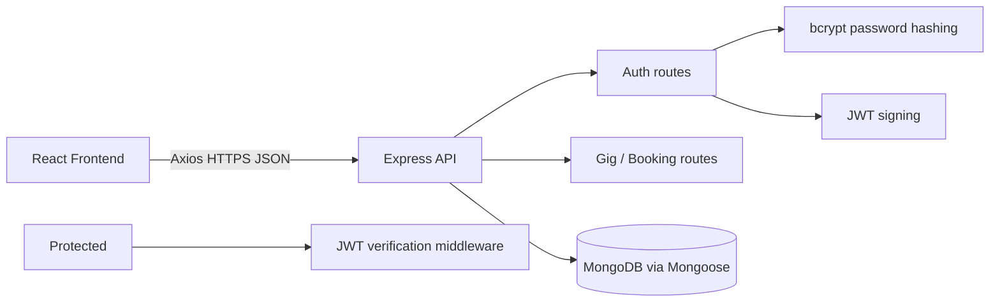

# HustleHub+ Full Stack

Secure MERN marketplace for the HustleHub+ platform. The Part 2 release adds MongoDB persistence, role-based gig and booking workflows, security controls, and a React client.

## System Overview

The API is an Express application served over HTTPS in local development. Users register with an email, password, and role. Passwords are hashed before storage, and successful registration or login returns a short-lived JWT.



The frontend uses JWTs stored in browser local storage and sends them through an Axios interceptor. MongoDB persists users, gigs, bookings, and transactions.

## Project Structure

```text
src/
├── config/cert/       Local HTTPS key and certificate (ignored by Git)
├── controllers/       Registration, login, and dashboard behavior
├── middleware/        Validation, authentication, and error handling
├── models/            MongoDB user, gig, booking, and transaction models
├── routes/            Express route definitions
└── utils/             Password and JWT helpers
scripts/               Local certificate generation
server.js              Express app and HTTPS entry point
```

## Security Decisions

- **Password hashing:** `bcryptjs` hashes passwords with 10 salt rounds. Plaintext passwords are never stored or returned.
- **JWT:** tokens are signed with `JWT_SECRET` and expire after one hour. Protected routes verify the signature before using token claims.
- **Input validation:** `express-validator` enforces normalized email addresses, eight-character minimum passwords, uppercase/lowercase/number/special-character requirements, and approved roles.
- **HTTPS:** a self-signed localhost certificate encrypts local traffic. It is suitable for development only; production should use a certificate issued by a trusted authority.
- **Error handling:** production responses hide stack traces and use a generic message. Development responses include the stack to aid debugging.
- **Additional controls:** Helmet security headers, CORS support, a 10 KB JSON body limit, HTTP parameter pollution protection, and account lockout after five failed logins for 15 minutes are enabled.
- **Audit logging:** Winston records login outcomes, bookings, transactions, and request errors as timestamped JSON in `logs/`; the logs are excluded from Git.

## Setup

Requirements: Node.js 18 or newer.

```powershell
npm.cmd install
Copy-Item .env.example .env
npm.cmd run cert:generate
npm.cmd start
```

The API starts at `https://localhost:8443`. Because the certificate is self-signed, disable SSL certificate verification in Postman or trust the certificate in your local client. Do not commit `.env` or PEM files.

For a backend started directly from VS Code, `MONGO_URI` should point to the host MongoDB instance, for example `mongodb://127.0.0.1:27017/hustlehub`. Docker Compose supplies `mongodb://mongodb:27017/hustlehub` to the backend container so it connects to the Compose MongoDB service; do not use `127.0.0.1` from inside that container.

## Postman

The Postman files are in the `postman/` folder:

1. Import `HustleHub-Local.postman_environment.json`.
2. Import `HustleHub-Part1.postman_collection.json`.
3. Select the `HustleHub Local` environment in Postman.
4. Confirm the `baseUrl` variable is `https://localhost:8443`.
5. In Postman Settings, turn off SSL certificate verification for the self-signed local certificate.
6. Run `Health`, then `Register Freelancer` or `Login`, and finally `Protected Dashboard`.

Each request includes a visible Postman test script under the request's **Scripts** tab. If the collection was imported before the latest update, delete the old imported collection and import `HustleHub-Part1.postman_collection.json` again; Postman does not automatically refresh imported files.

The login and registration requests automatically save the returned JWT in the environment's `token` variable. The base URL for this local server is:

```text
https://localhost:8443
```

For development with automatic restart:

```powershell
npm.cmd run dev
```

PowerShell may block `npm.ps1` under a restrictive execution policy; `npm.cmd` works without changing that policy.

## API Endpoints

### Register

`POST /api/auth/register`

```json
{
  "email": "freelancer@example.com",
  "password": "SecurePass123!",
  "role": "freelancer"
}
```

Returns `201` with a token and public user details. Duplicate emails return `400`; invalid input returns `400` with validation errors.

### Login

`POST /api/auth/login`

```json
{
  "email": "freelancer@example.com",
  "password": "SecurePass123!"
}
```

Returns `200` with a token and public user details. Invalid credentials return `401`.

### Dashboard

`GET /api/protected/dashboard`

```text
Authorization: Bearer <token>
```

Returns `200` with the authenticated JWT claims. Missing or invalid tokens return `401`.

### Freelancer tax estimate

`GET /api/tax/estimate` requires a freelancer JWT and returns `totalIncome`, `estimatedTax`, and `netIncome`. The estimate applies the provided SARS 2024/25 individual tax brackets to all recorded earning transactions for that freelancer. It is an estimate before rebates and tax credits; transaction totals are not filtered by tax-year dates.

### Health

`GET /health` returns `{ "status": "ok" }` and is useful for a basic availability check.

## Testing

Run the automated API checks with:

```powershell
npm.cmd test
```

The tests cover the SARS tax-bracket calculation and the API's registration, login, JWT-protected access, validation rejection, and missing authentication.

## Part 2 Setup

1. Install and start MongoDB locally, or create a MongoDB Atlas database.
2. Copy `.env.example` to `.env` and set `MONGO_URI` to the local or Atlas connection string. Set a long random `JWT_SECRET`.
3. Generate the local certificate with `npm.cmd run cert:generate`.
4. Start the API with `npm.cmd start`.
5. In a second terminal, run `Set-Location frontend; npm.cmd install; npm.cmd run dev`.

The frontend runs on the Vite URL shown in the terminal. Set `frontend/.env` from `frontend/.env.example` if the API URL differs from `https://localhost:8443/api`.
Freelancers can open the dedicated **Tax estimate** page from the navigation to see booking income, estimated tax, net income, and the calculation notes. The estimate updates when clients book their gigs; only the freelancer can view their tax figures.

## Marketplace and RBAC

- Clients can browse gigs, create bookings, and view their bookings.
- Freelancers can create, update, and delete their own gigs, view incoming bookings, and view transaction earnings.
- Admins can manage gigs and view marketplace records through the protected API.
- Gigs belong to their creating freelancer; ownership is checked on update and delete.
- Booking creation records both a confirmed booking and an earning transaction.

## Security Controls

JWT authentication, bcrypt password hashing, HTTPS, Helmet CSP headers, CORS, 10 KB JSON limits, express-validator input validation, MongoDB query sanitisation, HTTP parameter pollution protection, a 10-request-per-15-minute authentication rate limit, and 15-minute account lockout after five incorrect passwords are enabled.

## Logging and monitoring

Winston writes timestamped JSON events to `logs/combined.log` and errors to `logs/error.log`, as well as to the console. Login-attempt records help identify repeated credential guessing; booking and transaction records provide an audit trail for marketplace activity and financial disputes; error records help diagnose failed requests. Keep log files access-controlled and apply an appropriate retention policy because they contain account and transaction identifiers.

## CI, static analysis, and containers

GitHub Actions runs backend tests and ESLint, frontend tests, ESLint and a production build, then builds the backend and frontend Docker images on pushes and pull requests to `main`. The CI backend test job starts MongoDB as a service.

To run the three services locally, set a strong `JWT_SECRET` in the shell or in the root `.env` file, then run. Compose loads the secret from `.env` but overrides the host-local `MONGO_URI` with its internal MongoDB service address:

```powershell
docker compose up --build
```

The React app is served at `http://127.0.0.1:5173`, the HTTPS API at `https://localhost:8443`, and MongoDB uses a persistent Compose volume. The frontend Nginx server proxies `/api` requests to the backend. The backend image generates its own self-signed HTTPS certificate; use a trusted certificate and secure secret management for a production deployment.

Submission screenshots of successful GitHub Actions runs and running containers must be captured from the GitHub repository and Docker environment; they cannot be generated by the source changes alone.

## Part 2 Postman

Import `postman/HustleHub-Local.postman_environment.json` and `postman/HustleHub-Part2.postman_collection.json`. Select the environment, disable SSL certificate verification for the local self-signed certificate, and run requests in order: Health, Register Freelancer, Create Gig, Register Client, Browse Gigs, Book Gig, Freelancer Bookings, Freelancer Transactions, Freelancer Tax Estimate. The collection saves tokens and the gig ID automatically and checks the tax response fields.

## Testing

```powershell
npm.cmd test
npm.cmd run test:jest
Set-Location frontend; npm.cmd test; npm.cmd run build
```
---

# 🚀 Part 3: DevSecOps, Monitoring, and Finalisation

This section details the finalisation of the HustleHub+ platform, focusing on financial insights, automated CI/CD pipelines, containerization, comprehensive logging, and a final security review.

## 1. Financial Insights & Tax Estimation
To provide freelancers with financial clarity, the system calculates estimated tax obligations based on their total income generated from bookings.

**Tax Calculation Logic:**
The backend utilizes a custom algorithm based on the South African Revenue Service (SARS) 2024/2025 individual tax brackets. 
- Income is aggregated from the `Transaction` collection.
- The calculation applies progressive tax rates (e.g., 18% for income up to R237,100, scaling up to 45% for income above R1,817,000).
- The frontend consumes this API endpoint and visually displays the `Total Income`, `Estimated Tax`, and `Net Income` using a bar chart (via the Recharts library) for easy interpretation.


## 2. CI/CD Pipeline (GitHub Actions)
The project implements a robust Continuous Integration/Continuous Deployment (CI/CD) pipeline using **GitHub Actions** (`.github/workflows/ci.yml`). The pipeline triggers automatically on pushes and pull requests to the `main` branch.

**Pipeline Stages:**
1. **Dependency Installation:** Ensures clean installation of backend and frontend packages.
2. **Static Code Analysis:** Runs **ESLint** to analyze code for syntax errors, security vulnerabilities, and code style issues before deployment. The pipeline is configured to **fail** if linting errors are found.
3. **Automated Testing:** Executes backend unit/API tests (Jest/Supertest) and frontend component tests (Vitest).
4. **Build Process:** Compiles the React frontend to ensure there are no production build errors.
5. **Docker Verification:** Builds the Docker images to ensure the containerization configuration is valid.

**Static Analysis Results:**
*( "ESLint ran successfully with 0 errors. The results indicate that the codebase adheres to standard JavaScript security practices, with no unused variables or unsafe assignments detected.")*

## 3. Containerization (Docker & Docker Compose)
The entire application stack is containerized to ensure consistency across different environments and simplify deployment.

- **Backend Dockerfile:** Uses a Node.js Alpine image to keep the footprint small.
- **Frontend Dockerfile:** Uses a multi-stage build (Node.js for building the React app, then Nginx for serving the static files securely).
- **Docker Compose:** Orchestrates the MongoDB database, Express backend, and React frontend. 

To run the full stack via Docker:
```bash
docker-compose up --build -d
The backend API tests require a MongoDB instance at `MONGO_TEST_URI` (default: `mongodb://127.0.0.1:27017/hustlehub_test`); the CI workflow starts MongoDB for these tests. The tax-bracket and endpoint response tests run without a database. Newman can run the prepared collection after the API and MongoDB are running:

```powershell
npx.cmd newman run postman/HustleHub-Part2.postman_collection.json -e postman/HustleHub-Local.postman_environment.json --insecure
```
Video Link:https://youtu.be/tpz4MQ5F51g


## Submission Checklist

- [x] Dependencies and scripts configured
- [x] Environment template and Git exclusions added
- [x] HTTPS certificate generation documented and automated
- [x] MongoDB persistence and Mongoose models implemented
- [x] bcrypt password hashing implemented
- [x] JWT generation and verification implemented
- [x] Registration and login routes implemented
- [x] Input validation implemented
- [x] Global error handling implemented
- [x] Protected route implemented
- [x] Automated API tests included
- [x] README documentation included
- [x] React frontend, marketplace workflow, and frontend test included
- [x] Part 2 Postman collection included
- [x] Updated README: Comprehensive documentation
- [x] Backend & Frontend Code: Final working versions.
- [x] Pipeline Configuration: .github/workflows/ci.yml.
- [x] Static Analysis Result: A screenshot of the ESLint/CodeQL output in the GitHub Actions tab.
- [x] Docker Files: backend/Dockerfile, frontend/Dockerfile, and docker-compose.yml.
- [x] Logging Evidence: Screenshots of the logs/combined.log file showing a login attempt and a booking transaction.
- [x] Postman & Newman Evidence: Exported JSON and a screenshot of the Newman CLI run.
- [x] Screenshots: Frontend dashboard showing the Tax Bar Chart, MongoDB Compass showing the transaction data.
- [x] Demonstration Video: Show the full flow (Register → Create Gig → Book → View Income/Tax).


